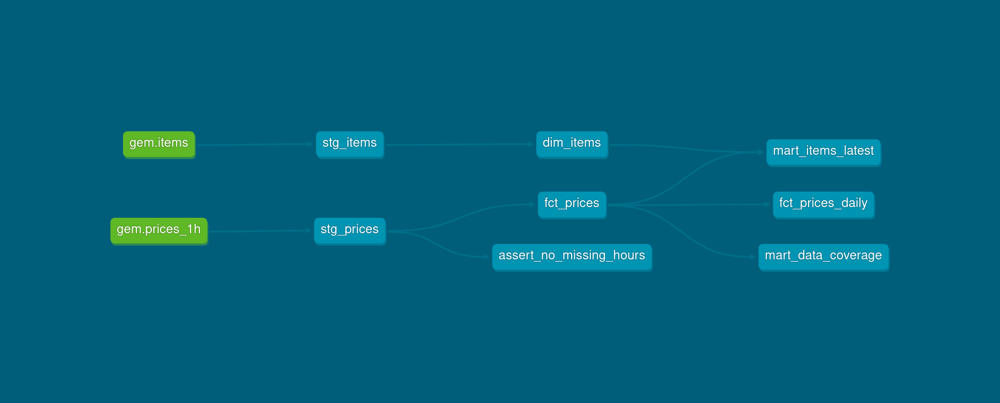

# Grand Exchange Metrics

`gem` is a small ELT pipeline for collecting and analyzing Old School RuneScape Grand Exchange price data.

It fetches hourly price data from the OSRS Wiki API, archives the raw JSON, loads it into PostgreSQL as-is, and models it with dbt into staging views and analysis marts.

## Requirements

* Python 3.14+
* PostgreSQL 18+
* dbt 1.10+ (`dbt-core`, `dbt-postgres`)

Python packages:

```text
dbt-core
dbt-postgres
psycopg
requests
tabulate
matplotlib
pytest
pytest-postgresql
```

## Installation

Clone the repository:

```bash
git clone https://github.com/mhiillos/gem.git
cd gem
```

Create a virtual environment:

```bash
python -m venv venv
source venv/bin/activate
```

Install:

```bash
pip install -e .
```

## Database setup

Create the database:

```sql
CREATE DATABASE gem;
```

Set the database connection. Python reads `DB_URL` and dbt reads the `PG*` variables, so both must point at the same database. Copy the example file:

```bash
cp .env.example .env
```

Fill in your username and password in `.env`:

```text
DB_URL=postgresql://<username>:<password>@localhost:5432/gem
PGHOST=localhost
PGUSER=<username>
PGPASSWORD=<password>
PGPORT=5432
PGDATABASE=gem
```

Load the variables into your shell (repeat in every new shell before running `gem` or `dbt`):

```bash
set -a; source .env; set +a
```

Initialize the raw tables:

```bash
python -m scripts.init_db
```

## dbt setup

The dbt project lives in `dbt/gem_dbt/`, with a `profiles.yml` that reads the `PG*` variables. Run dbt commands from that directory.

Install the dbt packages and check the connection:

```bash
cd dbt/gem_dbt
dbt deps
dbt debug
```

Load the first prices and build the models:

```bash
gem update
dbt build
```

`gem analyze` and `gem graph` read the dbt marts, so `dbt build` has to run once before they work.

## Pipeline

```text
OSRS Wiki API (/1h, /mapping)
      ↓  gem update: fetch
raw JSON archive (data/raw/)
      ↓  gem update: load
PostgreSQL raw tables
      ↓  dbt run
staging views → marts
      ↓
gem analyze / gem graph
```

Python only extracts and loads: the JSON is flattened into rows with the API's own column names. All renaming, cleaning and calculations happen in dbt.

Raw JSON is stored under:

```text
data/raw/prices_1h/YYYY-MM-DD/<fetch time>.json   one hourly window per file
data/raw/items/<fetch time>.json                  item mapping, written only when it changes
```

The archive is the source of truth: `gem backfill` replays it into the raw tables without calling the API.

## Usage

Fetch the last completed hour and load it into the database:

```bash
gem update
```

Load archived files that are not in the database yet:

```bash
gem backfill
```

Force a backfill, re-reading every archived file (already loaded rows are skipped):

```bash
gem backfill --force
```

Run an analysis query:

```bash
gem analyze alch
```

Graph an item's high and low prices over the last 7 days:

```bash
gem graph "Abyssal whip"
```

Run tests:

```bash
pytest -q
```

## Database

Each layer has its own schema. Python writes only `raw`; dbt builds everything after it.

| Schema | Built by | Contents |
|---|---|---|
| `raw` | Python | `prices_1h`, `items`, close to the API shape |
| `dev_staging` | dbt | `stg_prices`, `stg_items` views |
| `dev_marts` | dbt | `dim_items`, `fct_prices`, `fct_prices_daily`, `mart_items_latest`, `mart_data_coverage` tables |

The dbt lineage graph shows how the models build on each other, from the raw sources through the staging views to the marts:



* `stg_prices`, `stg_items`: rename the raw columns, set missing volumes to 0, and add a `price_id` key.
* `dim_items`: one row per item with its current name, buy limit and alch values.
* `fct_prices`: one row per item per hour with high, low and mean price, volumes, spread and rolling 24h averages. Each run rebuilds only the newest 48 hours.
* `fct_prices_daily`: one row per item per UTC day with volume-weighted prices, day-over-day and week-over-week changes, and 7-day volatility. The unfinished current day is left out.
* `mart_items_latest`: one row per item with the newest prices, 24h volume, alch profit and flip margin after the 2% GE tax.
* `mart_data_coverage`: one row comparing expected and loaded hourly windows.

Prices are NULL when nothing traded in that hour, never 0. Columns ending in `_pct` are percentages multiplied by 100 (`5.2` means 5.2%). `raw.prices_1h` is unique on `(item_id, window_timestamp)`, so reloading the same window does not create duplicate records.

Every model and column is described in the dbt docs. Generate and open them, including an interactive version of the lineage graph:

```bash
cd dbt/gem_dbt
dbt docs generate
dbt docs serve
```

## Automation

Each run needs both steps, in order: `gem update` fetches the last completed hour and loads it into `raw`, then `dbt run` rebuilds the models from it.

For example, a script `cron_update.sh`:

```bash
#!/bin/bash
set -e

cd /home/user/projects/gem
set -a; source .env; set +a
venv/bin/gem update
venv/bin/dbt run --project-dir dbt/gem_dbt --profiles-dir dbt/gem_dbt
```

run by an hourly cron job:

```cron
10 * * * * /home/user/projects/gem/cron_update.sh >> /home/user/projects/gem/logs.log 2>&1
```

The job runs at 10 minutes past the hour because the API publishes the previous hour a few minutes after it ends. It uses `dbt run` rather than `dbt build`, so a failing test can't stop the marts from updating.

**If the job doesn't run every hour, a full run is required.** `gem update` only fetches the last completed hour, so missed hours are not filled in automatically. The API keeps roughly 5 days of history. Fetch each missed hour by its start time (UTC) and load it:

```bash
python -c "from gem.ingestion.fetch_1h import fetch_1h; fetch_1h($(date -u -d '2026-11-10 13:00' +%s))"
gem backfill
```

`fct_prices` only rebuilds its newest 48 hours, so recovered hours older than that are not picked up by a normal `dbt run`. Rebuild everything from scratch:

```bash
cd dbt/gem_dbt
dbt run --full-refresh
```

